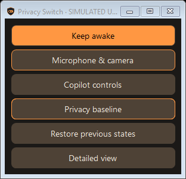

# PrivacySwitch — school pilot

A local Windows utility for privacy controls, saved profiles and activity inspection. This is an unfinished, free school pilot by Bobbie á Deild.

## What it does

- Build ordered profiles and select a theme and English or Swedish interface.
- Mute microphones, control supported cameras, close supported AI apps and review their coverage.
- Compare supported Windows privacy preferences and tracked startup registrations with a saved baseline.
- Inspect local processes, network endpoints and review markers in Privacy Insights.
- Use temporary Offline and Keep Awake controls, recorded recovery, encrypted-file tools and Windows Power User shortcuts.
- Switch between the detailed interface and a small vertical remote using Compact view. Detailed view returns to the full interface.

Coverage is limited to the settings and observations described in the app. Network endpoints do not reveal the contents or purpose of encrypted traffic. A baseline is not a record of every Windows setting.

## Release status

**v105 school pilot** includes the creator-approved compact remote. Download the complete ZIP from [Releases](https://github.com/bobbieadeildedunord/PrivacySwitch/releases/tag/v105-pilot), extract it and read START-HERE-EN.md before launch. The pilot is for authorised personal testing under the included agreement.

The application source is private. This repository is intended for public documentation, roadmap, feedback and packaged pilot downloads. The pilot is not an open-source release. Read [the pilot agreement](PILOT-AGREEMENT-EN.md) before use.

## Testing

Use your own or an authorised Windows computer. Save your work and review recovery before changing devices or networking. USB Break and New Removable Device Installs are experimental and activation is pilot locked; genuine recorded recovery remains available.

Start with [the test catalogue](PILOT-MASTER-CATALOGUE.md), then choose an [Alpha–Juliet assignment](PILOT-ASSIGNMENTS.md). The catalogue contains 120 cases across ten sections. Unavailable tests stay NOT RUN; a prepared checklist is not evidence that tests passed.

Read [known issues](KNOWN-ISSUES.md), [antivirus information](ANTIVIRUS.md), [roadmap](ROADMAP.md) and [profile storage scope](PROFILE-SETTINGS-MATRIX.md).

## Feedback and donations

Send the version, Windows edition/build, steps and observed result through https://bobbie.se/contact.html. Review reports for private information before sharing. Feedback is not uploaded automatically.

Testing is free. Donations are optional, 0–10 SEK: https://paypal.me/bobbieadeild/10. Check the currency is SEK and the amount is no more than 10 SEK before approving. Donating does not unlock features.

Copyright © Bobbie á Deild — https://bobbie.se/

## Compact remote preview

This preview uses simulated states. Actual buttons follow the selected profile and observed module status.
